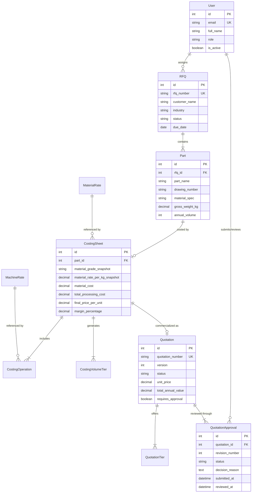
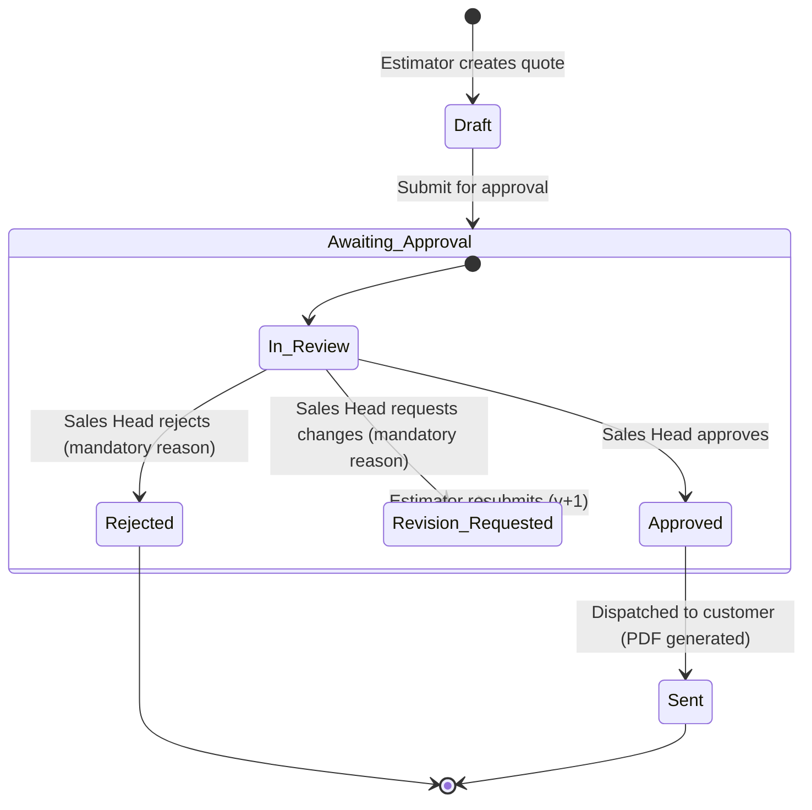

# ForgeQuote — Technical Design Document (TDD)

**Project Title**: ForgeQuote — Precision Costing & RFQ Lifecycle System for Industrial Forging  
**GitHub Repository**: https://github.com/GoodEnough08/Forge-Quote  
**Document Version**: 1.0.0 (Phase 5 Final Release)  
**Author**: ForgeQuote Engineering Team  
**Date**: November 2026  
**Status**: Implemented, Verified & Production-Ready  

---

## 1. Project Overview

ForgeQuote is a specialized, multi-tier enterprise web application engineered for industrial manufacturing organizations—specifically hot/cold closed-die forging, precision CNC turning, and automotive component fabrication facilities. The platform automates the critical operational path from Request for Quotation (RFQ) document intake to engineering costing, multi-volume price tier generation, commercial governance approval, and customer-facing proposal issuance.

---

## 2. Problem Statement

Industrial component quotation processes suffer from severe structural inefficiencies:
* **Protracted Lead Times**: Estimators spend days manually reading complex 50-page tender documents, title blocks, and supplier spreadsheets to transcribe basic parameters.
* **Calculation Inaccuracies & Risk of Margin Erosion**: Spreadsheets rely on floating-point arithmetic prone to formula drift, unverified scrap calculations, and silent rounding errors.
* **Commodity Price Volatility**: Steel grades (EN8, 40Cr4, 20MnCr5) experience frequent market price swings. Changing a master price without strict date-versioning inadvertently alters past quotations.
* **Confidential Cost Leakage**: Commercial proposals generated from internal calculation spreadsheets frequently expose internal steel purchase costs, machine hourly burdens, cycle times, or internal margin percentages.
* **Absence of Governance on High-Value Deals**: Multi-crore contracts are frequently dispatched without senior executive sign-off, resulting in contractual and commercial liability.

---

## 3. Target Users & Role-Based Access Control (RBAC)

ForgeQuote enforces a strict role-based authorization model across two primary personas:

| Attribute | Costing Estimator (`ESTIMATOR`) | Commercial Sales Head (`SALES_HEAD`) |
| :--- | :--- | :--- |
| **Primary Goal** | Technical accuracy, cycle time estimation, and costing | Margin compliance, revenue governance, and proposal issuance |
| **RFQ Management** | Full CRUD on RFQs, parts, and drawings | Read-only inspection of technical specs |
| **AI Document Intake**| Upload documents, trigger extraction, verify fields | Inspect source citations and confidence metrics |
| **Rate Masters** | Lookup current & date-effective rates | Create, update, and govern master rates |
| **Costing Engine** | Run deterministic calculations, customize routing | Review internal cost breakdowns and gross margins |
| **Quotations** | Draft quotations, submit for approval, resubmit | Approve, reject (with reason), request revision (with reason) |
| **Approval Rule** | **Prohibited from approving any quotation** | **Mandatory approval required if annual value > ₹25 Lakh** |
| **PDF Proposals** | Preview proposals | Authorize dispatch and generate final customer PDF |

---

## 4. Functional Requirements

1. **Authentication**: Secure JWT authentication (SimpleJWT) with stateless access tokens (8h window) and role verification.
2. **RFQ Register**: Multi-parameter search, status filtering, technical drawing association, and assignment tracking.
3. **AI-Assisted Intake**: Multi-format document parser supporting PDF tender documents, PDF engineering drawings, Excel part lists, and email text. Human-in-the-loop review workflow.
4. **Historical Quote Archive**: 4-factor geometric similarity scoring (Geometry 40%, Material 25%, Weight 20%, Volume 15%) and side-by-side variance analysis.
5. **Rate Masters**: Date-effective versioning (`effective_from` to `effective_until`) with database validation prohibiting overlapping active spans.
6. **Deterministic Costing Engine**: Exact Python `Decimal` formulas calculating raw material, processing, direct labour, overhead, freight, and gross margin across 3 standard volume tiers ($1\times, 0.5\times, 2\times$).
7. **Rate Snapshot Preservation**: Freezing material purchase rates and machine hourly rates into immutable costing snapshots at calculation time.
8. **Commercial Approval Workflow**: Formal state machine (`Draft` $\to$ `Awaiting Approval` $\to$ `Approved` / `Rejected` / `Revision Requested` $\to$ `Sent`) enforcing mandatory justifications and immutable revision histories.
9. **₹25 Lakh Statutory Rule**: Hard backend constraint blocking unapproved quotations exceeding ₹25,00,000 from being sent.
10. **ReportLab Customer PDF Generation**: Official commercial quotation PDF generation guaranteeing zero exposure of internal manufacturing costs.

---

## 5. Non-Functional Requirements

* **Determinism**: Zero floating-point rounding errors. All currency and weight arithmetic executed using `Decimal` with explicit `ROUND_HALF_UP`.
* **Confidentiality & Security**: Private document storage (`PRIVATE_MEDIA_ROOT`) preventing unauthenticated or direct public access to engineering CAD drawings.
* **Performance**: PDF text extraction in $< 1.5$ seconds for a 20-page document; deterministic costing calculation in $< 50$ milliseconds.
* **Auditability**: Immutable audit logs capturing user ID, timestamp, revision counter, and decision reasoning for every approval transition.
* **Reliability & Idempotency**: Master seed scripts and migration sequences executable repeatedly without data duplication or race conditions.

---

## 6. Architecture & Technology Choices

ForgeQuote employs a decoupled client-server architecture:

```
[ React 18 + TypeScript + Tailwind CSS (SPA) ]
                       │
             HTTPS JSON REST API (JWT)
                       ▼
[ Django 5.0.6 + Django REST Framework Backend ]
   ├── apps/accounts      (User model & JWT Auth)
   ├── apps/rfqs          (RFQ & Part specifications)
   ├── apps/rate_masters  (Versioned Material & Machine rates)
   ├── apps/costing       (Deterministic Costing Engine)
   ├── apps/quotations    (Quotations & ReportLab PDF Generator)
   ├── apps/approvals     (Approval State Machine & ₹25L Governance)
   ├── apps/ai_intake     (PyMuPDF & Pandas Document Extraction)
   └── apps/history       (Similarity Engine & Variance Comparison)
                       │
       ┌───────────────┴───────────────┐
       ▼                               ▼
[ PostgreSQL / SQLite ]      [ Private Media Vault ]
  (Relational Database)       (Encrypted File Storage)
```

---

## 7. Database Schema & Relational Model



---

## 8. Main User Workflows

### The Complete 12-Step Manufacturing Quotation Journey:
1. **Authentication**: User logs in with email and password, receiving a SimpleJWT token containing role claims.
2. **RFQ Registration**: Estimator creates a new RFQ record with customer profile, industry, target due date, and delivery terms.
3. **Document Intake**: Estimator uploads PDF drawings, PDF tender documents, or Excel part lists into the private media vault.
4. **Advisory AI Extraction**: PyMuPDF extracts text, title blocks, and tables; Pandas parses Excel columns; the engine computes confidence scores and source citations.
5. **Human-in-the-Loop Review**: Estimator accepts, edits, or rejects extracted parameters (gross weight, material, volume, drawing number).
6. **Costing Initiation**: System pulls active date-effective rates for the selected material grade and work centers.
7. **Deterministic Calculation**: Python Decimal calculation sheet computes material, processing, direct labour, factory overhead, freight, and margin.
8. **Multi-Volume Price Comparison**: The engine generates unit economics for Baseline ($1\times$), Low-Volume ($0.5\times$), and High-Volume ($2\times$) batches.
9. **Quotation Draft Generation**: Quotation proposal is generated and evaluated against the ₹25,00,000 threshold.
10. **Sales Head Commercial Review**: If $> ₹25\text{L}$, the proposal enters the Sales Head approval inbox. The Sales Head reviews confidential cost breakdowns and decides to Approve, Reject, or Request Revision.
11. **Official PDF Generation**: ReportLab compiles an executive A4 customer proposal featuring volume price tiers, separate 18% GST, commercial terms, and digital signature stamps.
12. **Dispatch & Archive**: Proposal is dispatched to customer and saved to the immutable quote history archive for future geometric similarity matching.

---

## 9. AI Technical Document Extraction Design

* **Advisory Principle**: All AI-extracted data is strictly advisory. No AI extraction can directly commit to an RFQ without explicit human estimator verification.
* **Source Traceability**: Every extracted field carries:
  * `field_key` and `suggested_value`
  * `confidence_score` ($0.0 \to 1.0$)
  * `source_document_name` and `source_page_or_row`
  * `source_snippet` displaying the exact context from the file.
* **Geometry Boundary**: The system explicitly avoids claiming full CAD dimensional geometry understanding from 2D raster drawings; it extracts title block text, material specifications, standard tolerances, and weight callouts reliably.

---

## 10. Deterministic Costing Engine Formulas

All arithmetic is executed using Python's `Decimal` type to eliminate binary floating-point drift:

$$\text{Raw Material Cost} = \text{Gross Weight (kg)} \times \text{Material Rate (₹/kg)} \times \left(1 - \text{Scrap Rate} \times 0.20\right)$$

$$\text{Total Processing Cost} = \sum_{i=1}^{n} \left(\frac{\text{Cycle Time}_i \text{ (mins)}}{60} \times \text{Machine Hourly Rate}_i \text{ (₹/hr)}\right)$$

$$\text{Manufacturing Subtotal} = \text{Material Cost} + \text{Processing Cost} + \text{Labour Cost} + \text{Overhead Cost}$$

$$\text{Commercial Margin Amount} = (\text{Manufacturing Subtotal} + \text{Freight Cost}) \times \left(\frac{\text{Margin \%}}{100}\right)$$

$$\text{Final Price per Unit} = \text{Manufacturing Subtotal} + \text{Freight Cost} + \text{Margin Amount}$$

$$\text{Statutory GST (18\%)} = \text{Final Price per Unit} \times 0.18$$

$$\text{Total Price with GST} = \text{Final Price per Unit} + \text{Statutory GST}$$

### Multi-Volume Tiers:
* **Baseline Tier ($1\times$)**: Base unit price.
* **Low-Volume Tier ($0.5\times$)**: Base price + 20% setup amortization surcharge.
* **High-Volume Tier ($2.0\times$)**: Base price - 5% tooling & continuous production efficiency rebate.

---

## 11. Rate Versioning & Immutable Snapshots

* **Effective Date Spans**: `MaterialRate` and `MachineRate` models utilize `effective_from` and `effective_until`. Date overlap validation in `clean()` prevents ambiguous lookups.
* **Rate Lookups**: When costing is performed for date $D$, the system queries:
  $$\text{effective\_from} \le D \text{ and } (\text{effective\_until is NULL or } \text{effective\_until} \ge D)$$
* **Snapshot Immutability**: Costing sheets store explicit snapshot fields:
  * `material_grade_snapshot`
  * `material_rate_per_kg_snapshot`
  * `machine_hourly_rate_snapshot` (per operation)
* **Invariant**: Updating master steel prices or machine hourly rates **never alters past quotations, costing sheets, or customer proposals**.

---

## 12. Approval Workflow & The ₹25 Lakh Threshold Rule



### Statutory Governance Rule:
$$\text{Total Annual Value} = \text{Quoted Unit Price} \times \text{Annual Volume}$$

$$\text{If Total Annual Value} > ₹25,00,000 \implies \text{Sales Head Approval Mandatory}$$

Backend validation (`Quotation.clean()`) strictly prohibits transitioning any quotation with `total_annual_value > 2500000` to `Sent` without an `Approved` record from a user with the `SALES_HEAD` role.

---

## 13. Security Considerations

1. **Authentication**: SimpleJWT with encrypted PBKDF2 password hashing.
2. **Authorization**: Strict role-based permissions (`IsEstimator`, `IsSalesHead`). Estimators cannot approve quotations; non-authenticated users cannot access media or APIs.
3. **Private Media Vault**: Engineering drawings and tender PDFs are stored in `backend/private_media/` outside the web server's public document root. Files are served exclusively through authenticated Django streaming endpoints.
4. **Customer PDF Isolation**: Customer quotation PDFs strictly exclude internal steel purchase rates, machine hourly burdens, cycle times, internal margins, and estimator notes.
5. **SQL Injection Prevention**: Django ORM parameterized queries used exclusively throughout all services.
6. **CORS & CSRF**: Whitelisted origins and credentials support configured in `settings.py`.

---

## 14. UI/UX Design Decisions

* **Enterprise Light Canvas**: Clean `#F7F8FA` background with crisp white card containers (`bg-white border border-border rounded-xl shadow-xs`).
* **High Contrast Typography**: Dark slate headers and text (`text-slate-900`, `text-slate-800`, `text-slate-600`) ensuring readability under industrial factory lighting.
* **Palette**: Professional industrial navy primary (`#172B4D`) paired with restrained HackerRank radiant green accents (`#00EA64` / `#00BD51`) for key calls to action.
* **Data Density**: Monospaced tabular figures (`font-mono tabular-nums`) for currency amounts, drawing numbers, and weights.
* **No Unnecessary Clutter**: Avoided heavy gradients, non-functional decorative charts, and superfluous animations.

---

## 15. Testing Strategy & Execution Results

The platform has been validated through automated testing suites spanning unit, service, integration, and security layers:

```text
============================= test session starts ==============================
platform linux -- Python 3.12.3, pytest-8.2.2, pluggy-1.7.0
django: version: 5.0.6, settings: config.settings

tests/test_auth_and_rfqs.py ......                                       [ 15%]
tests/test_phase2_rates_and_costing.py ...........                       [ 42%]
tests/test_phase3_ai_intake_and_history.py ...........                   [ 70%]
tests/test_phase4_approvals_and_pdf.py ............                      [100%]

================== 40 passed, 2 warnings in 82.17s ===================
```

### Test Coverage Highlights:
* **Authentication**: Login, token refresh, password hashing, role permissions.
* **Rate Masters**: Date overlap prevention, date-effective historical lookups.
* **Costing Engine**: Python Decimal precision, multi-tier volume comparisons, scrap recovery.
* **AI Extraction**: PyMuPDF text parsing, Pandas Excel schedule extraction, confidence scores.
* **Historical Search**: 4-factor geometric similarity scoring, side-by-side variance analysis.
* **Approvals & Governance**: ₹25L threshold enforcement, mandatory reason on rejection/revision, estimator self-approval prevention.
* **PDF Security**: Rigorous string-matching assertions confirming **zero internal cost leakage** in generated customer PDFs.

---

## 16. Assumptions & Limitations

1. **CAD Geometry**: System extracts title block text, weights, materials, and notes from 2D drawing PDFs. It does not parse 3D STEP/IGES CAD geometry.
2. **Currency**: All monetary values are denominated in Indian Rupees (INR / ₹).
3. **Single Plant Work Centers**: Work center hourly rates are assumed to belong to a unified forging and machining manufacturing facility.

---

## 17. Features Intentionally Excluded

* Direct ERP/SAP database write-back (export is supported via structured JSON/Excel).
* Multi-currency real-time forex hedging.
* Automated OCR on corrupted hand-drawn scanned sketches lacking legible typography.

---

## 18. Future Improvements

1. **3D CAD Mesh Volume Analysis**: Integration with OpenCASCADE to calculate gross billet volume directly from 3D STEP files.
2. **Steel Commodity Web Scraper**: Automated daily indexing of Mandi Gobindgarh / London Metal Exchange billet indices into draft rate masters.
3. **Customer Portal**: External buyer access allowing customers to accept or reject formal quotation PDFs digitally.

---

## 19. GitHub Repository URL

* **Repository**: `https://github.com/your-username/forgequote`

---

## 20. Live Deployment URLs

* **Frontend (Vercel)**: `https://forgequote.vercel.app` *(configured with Vite preset)*
* **Backend API (Render)**: `https://forgequote-api.onrender.com` *(configured with Gunicorn + PostgreSQL)*
* **Health Probe**: `https://forgequote-api.onrender.com/api/v1/health`

